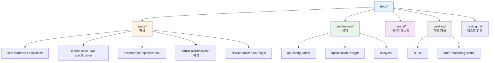

# Online DAW 문서

**Document Version**: 2.2  
**Software Version**: 0.1.0  
**Last Updated**: 2026-11-03

---

이 폴더는 Online DAW 프로젝트의 문서를 포함합니다. 문서는 한국어로만 관리합니다.

## 폴더 구조

| 폴더 | 성격 | 기준 |
|---|---|---|
| `specs/` | 기능의 동작, 포맷, 프로토콜, API 계약 | 현재 코드와 일치해야 함. 미구현 설계는 상단에 상태 명시 |
| `architecture/` | 구조, 설정, 최적화 기법, 설계 분석 | 현재 코드와 일치해야 함 |
| `manual/` | 사용자 관점의 사용법 | 현재 UI 동작과 일치해야 함 |
| `worklog/` | 검토 결과, Todo, 작업 인계 메모 | 작성 시점 기준 기록. 현재 코드와 다를 수 있음 |

## 명세서 (`specs/`)

- [`midi-standard-compliance.md`](./specs/midi-standard-compliance.md) - MIDI 표준(SMF, MIDI 1.0) 준수 사양
- [`project-save-load-specification.md`](./specs/project-save-load-specification.md) - 프로젝트 저장/불러오기 포맷
- [`collaboration-specification/`](./specs/collaboration-specification/README.md) - 실시간 협업 명세 (서버 API, P2P 프로토콜, 예외 처리)
- [`service-notices-and-login.md`](./specs/service-notices-and-login.md) - jace-s 연동: 서비스 공지 토스트(`/health`, `/notices`)와 로그인 세션·CSRF
- [`admin-authentication.md`](./specs/admin-authentication.md) - 관리자 인증·룸 관리 보안 설계 (**폐기: 설계 이력**)

## 아키텍처 (`architecture/`)

- [`README.md`](./architecture/README.md) - 아키텍처 문서 개요
- [`api-configuration.md`](./architecture/api-configuration.md) - jace-s API(`api.jace-s.com`)·WebSocket·로그인 화면 주소 설정
- [`optimization-design/index.md`](./architecture/optimization-design/index.md) - 성능 최적화 기법 (아키텍처 수준 / 구현 수준 / 데이터 접근)
- [`analysis/audio-playback-timing-jank-analysis.md`](./architecture/analysis/audio-playback-timing-jank-analysis.md) - 오디오 재생 렉과 노트 타이밍 지연 분석 및 개선 결과

## 사용자 매뉴얼 (`manual/`)

- [`README.md`](./manual/README.md) - 시작하기, 단축키, MIDI 편집, 트랙 관리, 재생, 저장/불러오기, 협업, 문제 해결

## 테스트

- [`testing.md`](./testing.md) - 통합 테스트 전략 (스크립트 → 브라우저 → 사용자 직접 확인)
- [`../case-tests/README.md`](../case-tests/README.md) - QA 고정 데이터와 상세 케이스 대응표

## 작업 기록 (`worklog/`)

명세가 아닌 작업 기록입니다. 작성 시점의 HEAD·작업 상태를 기준으로 하며 현재 코드와 다를 수 있습니다.

- [`TODO.md`](./worklog/TODO.md) - 프로젝트 검토 결과와 개선 Todo (구현 대기)
- [`auth-refactoring-status.md`](./worklog/auth-refactoring-status.md) - 인증·인가 리팩토링 작업 상태와 재개 절차

---

## 문서 작성 규칙

1. **언어**: 한국어만 사용. 파일명에 언어 접미사(`.ko`, `.en`)를 붙이지 않고 `*.md`로 작성 (2026-11-03 `*.ko.md` → `*.md` 일괄 변경)
2. **형식**: Markdown (.md)
3. **버전 정보**: 명세·아키텍처·매뉴얼 문서는 상단에 `Document Version`, `Software Version`, `Last Updated`를 명시
4. **링크**: 상대 경로 사용
5. **코드와의 관계**: 명세·아키텍처 문서는 현재 코드를 기준으로 작성. 미구현 설계는 문서 상단에 상태를 명시
6. **작업 기록 분리**: 검토 메모, Todo, 인계 메모는 `worklog/`에 둠

---

## 관련 문서

- [`../README.md`](../README.md) - 프로젝트 개요
