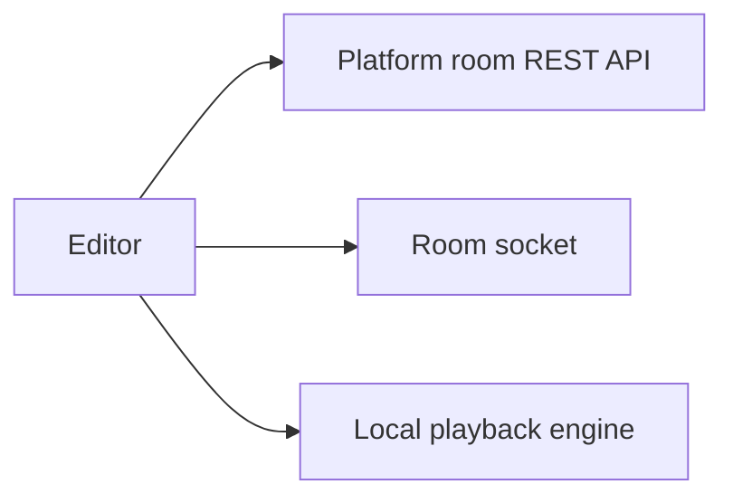

# Data Flow

The editor uses the platform REST API to create and manage collaboration rooms. After joining, the client uses the room socket for live collaboration signals. The playback engine schedules audio from the editor state on the client.

See [Architecture Overview](10-overview.md).
