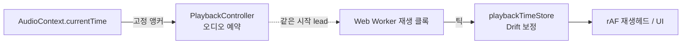
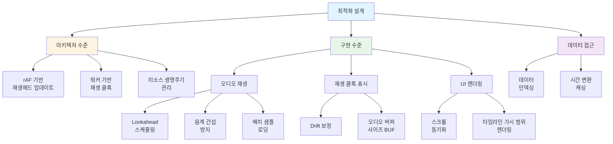

# 아키텍처 문서

**Document Version**: 2.0  
**Software Version**: 0.1.0  
**Last Updated**: 2026-11-03

---

## 문서 구조

| 구분 | 문서 | 내용 |
|---|---|---|
| 설정 | [`api-configuration.md`](./api-configuration.md) | jace-s API·WebSocket·로그인 화면 주소 설정 |
| 최적화 설계 | [`optimization-design/index.md`](./optimization-design/index.md) | 성능 최적화 기법 전체 목록 |
| 설계 분석 | [`analysis/audio-playback-timing-jank-analysis.md`](./analysis/audio-playback-timing-jank-analysis.md) | 재생 렉에 따른 노트 타이밍 지연 원인 분석과 개선 결과 |

---

## 재생 타이밍 구조 요약

재생 관련 문서는 아래 시계 분리를 전제로 합니다. 상세 근거는 [오디오 재생 타이밍 분석](./analysis/audio-playback-timing-jank-analysis.md)을 참고하십시오.

- **오디오 예약**: `AudioContext.currentTime` 기반 고정 앵커(`PlaybackAnchor`)로 노트·메트로놈 시각을 계산합니다. UI 재생 시간(`playbackTimeStore`)을 사용하지 않습니다.
- **UI 재생 시간**: Worker 클록 틱을 `playbackTimeStore`가 Drift 보정하여 재생헤드에 제공합니다. 표시 전용입니다.
- **시작 동기화**: 샘플 준비 후 오디오 앵커와 Worker 클록을 같은 lead(75ms)로 시작합니다.

---

## 최적화 설계 문서

### 아키텍처 수준
- [rAF 기반 재생헤드 업데이트](./optimization-design/architecture-level/raf-playback-head.md)
- [워커 기반 재생 클록](./optimization-design/architecture-level/worker-playback-clock.md)
- [리소스 생명주기 관리](./optimization-design/architecture-level/resource-lifecycle-management.md)

### 구현 수준

#### 오디오 재생
- [Lookahead 스케줄링](./optimization-design/implementation-level/audio-playback/lookahead-scheduling.md)
- [같은 음계 간섭 방지](./optimization-design/implementation-level/audio-playback/pitch-class-interference-prevention.md) (기본 비활성화)
- [배치 샘플 로딩](./optimization-design/implementation-level/audio-playback/batch-sample-loading.md)

#### 재생 클록·표시
- [Drift 보정 시스템](./optimization-design/implementation-level/playback-clock/drift-correction.md)
- [오디오 버퍼 사이즈 (BUF)](./optimization-design/implementation-level/playback-clock/audio-buffer-size.md)

#### UI 렌더링
- [MIDI 에디터 스크롤 동기화](./optimization-design/implementation-level/ui-rendering/scroll-synchronization.md)
- [타임라인 가시 범위 렌더링](./optimization-design/implementation-level/ui-rendering/timeline-visible-range-rendering.md)

### 데이터 접근
- [데이터 인덱싱](./optimization-design/data-access/indexing.md)
- [시간 변환 캐싱](./optimization-design/data-access/timing-cache.md)

---

**Document Version**: 2.0  
**Software Version**: 0.1.0  
**Last Updated**: 2026-11-03
