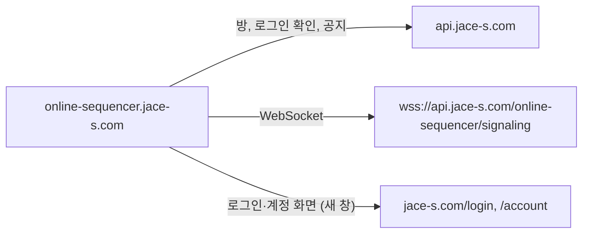

# API 설정

**Document Version**: 2.0  
**Software Version**: 0.1.0  
**Last Updated**: 2026-11-03

**카테고리**: 설정 관리

---

## 개요

jace-s API, 협업 WebSocket, 로그인 화면 주소를 설정값으로 관리합니다. 주소는 `src/utils/apiConfig.ts`에서만 만들며 코드 곳곳에 직접 쓰지 않습니다.

- 계약 원문: jace-s 저장소 `docs/api/apps/online-sequencer/` (`10-client-contract.md`, `20-health.md`, `30-app-contract.md`)
- 기준: jace-s 커밋 `9416e01` 이후 (2026-11-03 운영 반영)

---

## 환경 변수

| 변수 | 기본값 | 용도 |
|---|---|---|
| `VITE_API_URL` | `https://api.jace-s.com` | 모든 API 주소. origin만 사용하며 경로에 `/api`를 붙이지 않음 |
| `VITE_SITE_URL` | `https://jace-s.com` | 로그인 `/login`, 계정 `/account` 화면 |
| `VITE_NOTICE_APP_ID` | `41` | 공지 조회 `/notices?app=41` |
| `VITE_LOGIN_HOSTS` | `online-sequencer.jace-s.com` | 로그인 UI를 보여줄 호스트 (쉼표 구분) |

- 값은 Vite의 `import.meta.env`에서 먼저 읽고, 없으면 Node `process.env`에서 읽습니다 (스크립트 테스트용).
- 예전 변수 `VITE_API_BASE_URL`, `VITE_BASE_URL`, `VITE_API_PATH`는 더 이상 읽지 않습니다. 설정되어 있어도 무시됩니다.
- 운영 배포에서는 기본값이 계약과 같으므로 변수를 설정하지 않아도 됩니다.

---

## 주소 생성

| 함수 | 결과 |
|---|---|
| `getApiUrl()` | `https://api.jace-s.com` |
| `buildApiUrl('/rooms')` | `https://api.jace-s.com/online-sequencer/rooms` |
| `buildWebSocketUrl('/signaling', { clientId })` | `wss://api.jace-s.com/online-sequencer/signaling?clientId=...` |
| `getSiteUrl()` | `https://jace-s.com` |
| `getNoticeAppId()` | `41` |
| `isLoginAvailable()` | 브라우저(Electron 제외)이고 호스트가 `VITE_LOGIN_HOSTS`에 있으면 true |

- `http://` → `ws://`, `https://` → `wss://`로 변환합니다.
- 엔드포인트 앞의 `/`가 없으면 붙입니다.

### 사용처

| 요청 | 주소 | 위치 |
|---|---|---|
| 서버 생존 | `{API}/health` | `src/core/notices/serviceNotices.ts` |
| 공지 | `{API}/notices?app=41` | `src/core/notices/serviceNotices.ts` |
| 로그인 확인 | `{API}/auth/session` | `src/core/auth/jaceSession.ts` |
| 협업 REST | `{API}/online-sequencer/rooms...` | `src/core/sync/SignalingClient.ts` |
| 협업 WebSocket | `wss://{API host}/online-sequencer/signaling` | `src/core/sync/SignalingClient.ts` |
| QA 서버 확인 (개발 전용) | `{API}/health` | `src/pages/QaPage.tsx` |

---

## 예전 주소 (사용 금지)

| 예전 | 현재 |
|---|---|
| `https://jace-s.com/api/online-sequencer/...` | `https://api.jace-s.com/online-sequencer/...` |
| `https://api.jace-s.com/api/online-sequencer/...` | `https://api.jace-s.com/online-sequencer/...` |
| `wss://jace-s.com/api/online-sequencer/signaling` | `wss://api.jace-s.com/online-sequencer/signaling` |
| `https://jace-s.com/api/auth/session` | `https://api.jace-s.com/auth/session` |
| `https://jace-s.com/health` (공지 포함) | `https://api.jace-s.com/health` + `/notices?app=41` |
| `/external/health/...` (prewarm) | 부르지 않음 |
| `/api/auth/verify-password`, `GET /online-sequencer/rooms` (관리자) | 기능 제거 |

예전 주소는 전환 기간에만 동작하며, jace-s 운영자가 요청이 없어진 것을 확인한 뒤 닫습니다(이후 404).

---

**Last Updated**: 2026-11-03
