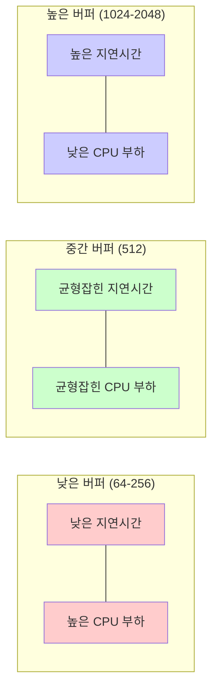
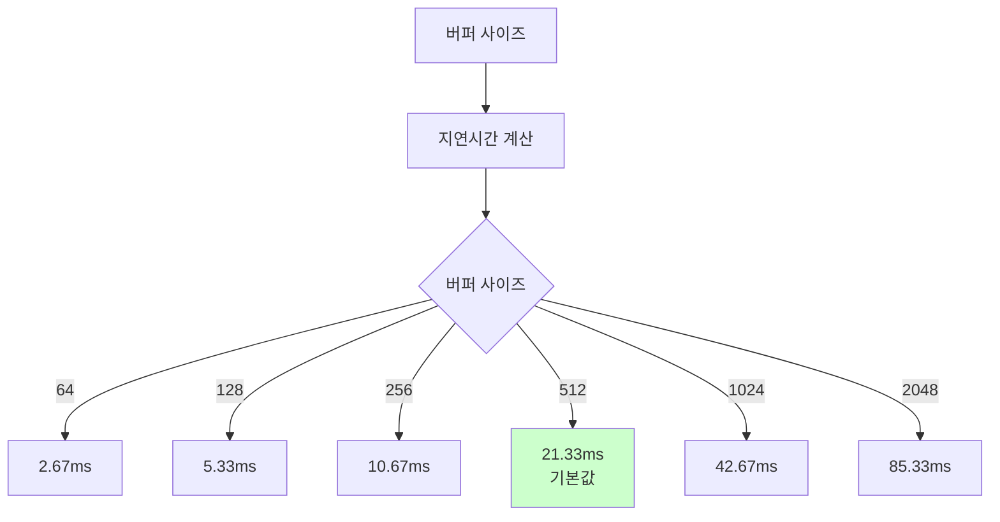

# 조절 가능한 오디오 버퍼 사이즈

**Document Version**: 1.2  
**Software Version**: 0.1.0  
**Last Updated**: 2026-11-03

**카테고리**: 구현 수준 - 재생 클록·표시

---

## 개요

개발자 패널의 `BUF` 설정으로 다음 두 값을 함께 조절하는 기능입니다.

1. UI 재생 클록(Worker)의 틱 간격
2. `AudioContext` 생성 시 전달하는 `latencyHint` 선호값

**주의**: 이 설정은 Web Audio의 실제 렌더링 버퍼 크기를 바꾸지 않습니다. Web Audio는 고정 128-frame render quantum을 사용하며, `latencyHint`는 브라우저가 해석할 재량이 있는 선호값입니다. 실제 지연은 `AudioContext.baseLatency`/`outputLatency`로 확인해야 합니다. 또한 BUF를 키워도 메인 스레드 렉으로 노트가 늦게 예약되는 문제는 해결되지 않습니다. 이 문제는 [오디오 앵커](../../analysis/audio-playback-timing-jank-analysis.ko.md)로 해결했습니다.

---

## 목표

- UI 틱 간격과 브라우저 출력 지연 선호값을 환경에 맞게 조절
- 출력 끊김(underrun)이 있는 환경에서 더 큰 `latencyHint`를 요청할 수 있는 수단 제공

---

## 구현 위치

- `src/constants/ui.ts`: 상수 정의
- `src/store/uiStore.tsx`: 상태 관리
- `src/components/Inspector/DeveloperPanel.tsx`: `BUF` UI 컨트롤 (개발자 패널)
- `src/components/Toolbar/TransportControls.tsx`: 틱 간격 계산
- `src/core/audio/AudioEngine.ts`: AudioContext latencyHint 적용/재생성

---

## 설정값

### 지원 버퍼 사이즈
- 64, 128, 256, 512, 1024, 2048 (2의 거듭제곱)
- 기본값: 512

### 기타 상수
- 샘플 레이트: 48000 Hz
- Periods: 2

### 버퍼 사이즈와 성능 트레이드오프 (일반적 경향)

아래는 일반적인 경향이며, 이 프로젝트에서 설정별 CPU 부하·실제 지연을 측정한 결과는 아닙니다.



---

## 틱 간격 계산

```typescript
intervalMs = round((bufferSize / SAMPLE_RATE) * PERIODS * 1000)
```

### 계산 예시
- 버퍼 사이즈 512: `(512 / 48000) * 2 * 1000 ≈ 21.33ms`
- 버퍼 사이즈 1024: `(1024 / 48000) * 2 * 1000 ≈ 42.67ms`

### 버퍼 사이즈별 계산값 (틱 간격 / latencyHint)

아래 값은 계산식 결과이며 실제 출력 지연이 아닙니다.



---

## AudioContext latencyHint 적용

```typescript
latencyHintSeconds = (bufferSize / SAMPLE_RATE) * PERIODS
```

- `AudioContext` 생성 시 `latencyHint`로 적용됨
- 재생 중 변경은 즉시 적용하지 않고, 재생이 멈춘 뒤 컨텍스트 재생성으로 반영
- 브라우저가 힌트를 수용하지 않을 수 있음 (환경에 따라 실제 레이턴시 상이)

---

## 주의사항

### 현재 상태
- UI 스케줄링(PlaybackClock tick 간격)과 AudioContext `latencyHint`에 모두 영향
- Web Audio API는 고정 128-frame render quantum을 사용하므로 실제 렌더링 블록 크기는 변경 불가
- `latencyHint` 변경은 컨텍스트 재생성이 필요하며, 재생 중에는 지연 적용됨

### 향후 계획
- 사용자 노출 명칭을 실제 의미에 맞게 정리 (예: `Low latency / Balanced / Stable playback` 프리셋)
- 진단 정보에 실제 `baseLatency`/`outputLatency` 표시
- UI 틱 간격을 출력 지연 힌트와 분리

---

## 효과

### 성능 트레이드오프
- 낮은 버퍼 (64-256):
  - 낮은 지연시간
  - 높은 CPU 부하
  - 시스템 응답성이 좋을 때 권장

- 중간 버퍼 (512):
  - 균형잡힌 지연시간과 CPU 부하
  - 기본값

- 높은 버퍼 (1024-2048):
  - 높은 지연시간
  - 낮은 CPU 부하
  - 시스템 성능이 낮을 때 권장

### 사용자 경험
- 시스템 성능에 따른 유연한 조절
- 개인 환경에 맞는 최적 설정 가능

---

## 관련 문서

- [`워커 기반 재생 클록`](../architecture-level/worker-playback-clock.ko.md)
- [`오디오 재생 타이밍 분석`](../../analysis/audio-playback-timing-jank-analysis.ko.md)

---

**Last Updated**: 2026-11-03
