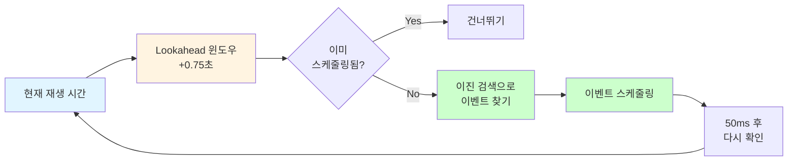
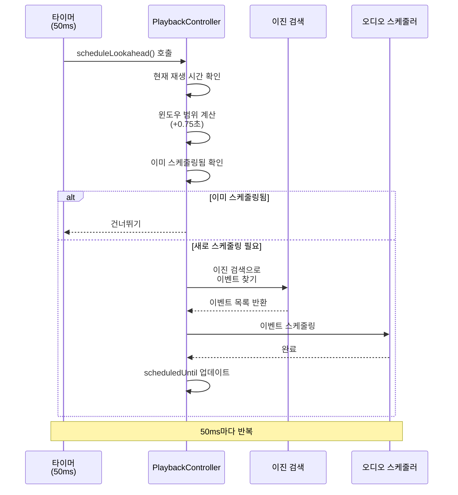

# Lookahead 스케줄링

**Document Version**: 1.0  
**Software Version**: 0.1.0  
**Last Updated**: 2026-11-03

**카테고리**: 구현 수준 - 오디오 재생 최적화

---

## 개요

오디오 이벤트를 미리 스케줄링하여 재생 안정성을 확보하는 최적화 기법입니다.

---

## 목표

- 오디오 이벤트를 미리 스케줄링하여 재생 안정성 확보
- CPU 부하 분산
- 이벤트 누락 방지

---

## 구현 위치

- `src/core/audio/PlaybackController.ts`

---

## 알고리즘

### Lookahead 윈도우
기본 0.75초 앞의 노트를 미리 스케줄링합니다. 개발자 패널에서 0~5초 범위로 조절할 수 있습니다 (`PlaybackController.setScheduleLookaheadSeconds`).

### 업데이트 간격
50ms마다 lookahead 윈도우를 갱신합니다.

### 이진 검색
현재 재생 시간 기준 이벤트 인덱스를 O(log n)으로 찾습니다.

### Lookahead 윈도우 다이어그램

```mermaid
gantt
    title Lookahead 스케줄링 윈도우
    dateFormat X
    axisFormat %L ms
    
    section 재생 시간
    현재 재생 시간 :0, 0
    
    section 스케줄링 윈도우
    이미 스케줄링됨 :0, 100
    새로 스케줄링 :100, 400
    
    section 미래
    아직 스케줄링 안됨 :500, 100
```





---

## 코드 구조

```typescript
const DEFAULT_SCHEDULE_LOOKAHEAD_SECONDS = 0.75; // 개발자 패널에서 0~5초로 변경 가능
const SCHEDULE_INTERVAL_MS = 50;

private scheduleLookahead(): void {
  const playbackTime = this.getCurrentTimelineTime(); // 고정 오디오 앵커 기준
  const windowEnd = playbackTime + this.scheduleLookaheadSeconds;
  if (windowEnd <= this.scheduledUntil) {
    return;
  }
  this.scheduleWindow(playbackTime, this.scheduledUntil, windowEnd);
  this.scheduledUntil = windowEnd;
}
```

---

## 동작 방식

### 스케줄링 플로우



### 1. 오디오 앵커 기준 재생 시간 확인
고정된 `AudioContext.currentTime` 앵커에서 계산한 타임라인 시간을 기준으로 lookahead 윈도우를 설정합니다.

### 2. 윈도우 범위 결정
현재 시간부터 lookahead(기본 0.75초) 앞까지의 범위를 스케줄링 대상으로 설정합니다.

### 3. 이미 스케줄링된 범위 건너뛰기
이미 스케줄링된 범위는 다시 스케줄링하지 않습니다.

### 4. 이벤트 스케줄링
윈도우 범위 내의 이벤트를 이진 검색으로 찾아 스케줄링합니다.

### 5. 주기적 갱신
50ms마다 위 과정을 반복하여 lookahead 윈도우를 유지합니다.

### 6. 늦은 노트 처리
스케줄러 호출이 늦어져 노트 시작 시각이 이미 지난 경우 (`resolveScheduledPlaybackWindow`):
- 아직 끝나지 않은 노트는 지난 샘플 구간을 건너뛰고(`skipTime`) 남은 길이만 재생합니다.
- 이미 끝난 노트는 건너뜁니다.
- 이벤트의 오디오 예약 시각은 고정 앵커에서 계산하므로 지연이 다음 이벤트로 누적되지 않습니다.

### 7. 진단 로그
- `schedule_tick_lag`: 스케줄러 호출 간격이 기대값보다 크게 늦은 경우
- `lookahead_low` / `lookahead_depleted`: 예약 잔량이 50ms 미만이거나 고갈된 경우
- `schedule_note_late`: 10ms 이상 늦게 처리된 노트

### 8. 자동 보정 (예약 고갈 대비)
메인 스레드 렉으로 예약 잔량이 50ms 미만이 되면 lookahead를 자동으로 늘립니다 (`nextAutoLookahead`, `src/core/audio/playbackTimeline.ts`).

| 값 | 내용 |
|---|---|
| 증가 단위 | 0.25초 |
| 상한 | 실제 적용 lookahead 2초. 수동 설정이 2초 이상이면 더 늘리지 않음 |
| 간격 | 증가 후 2초 동안은 다시 늘리지 않음 (한 번의 렉으로 여러 단계가 오르지 않도록) |
| 유지 | 늘린 값은 페이지를 닫거나 개발자 패널에서 RESET할 때까지 유지 |
| 제외 | 재생 시작·seek 직후 첫 예약(잔량 0이 정상)은 세지 않음 |
| 로그 | `lookahead_auto_increase` |

개발자 패널에서 `AUTO LOOKAHEAD`(ON/OFF), `EFFECTIVE`(적용 중인 값과 자동 증가분), `LOW / EMPTY`(잔량 부족·고갈 횟수, 최소 잔량), `RESET`을 확인·조작할 수 있습니다.

검증: 모의 환경 브라우저에서 재생 중 900ms 메인 스레드 정지를 3회 주입했을 때, 첫 고갈(최소 잔량 -202ms) 뒤 0.75초→1.00초로 한 번 늘었고 이후 정지에서는 고갈이 없었습니다. 실제 장치·청취 확인은 하지 않았습니다.

노래 전체 미리 렌더링이나 AudioWorklet 링버퍼는 편집 즉시 반영과 충돌하고 구조 변경이 커서 적용하지 않았습니다. 자동 보정 뒤에도 고갈이 반복될 때 검토합니다.

---

## 효과

### 재생 안정성
- 오디오 이벤트 누락 방지
- 재생 안정성 향상

### 성능
- CPU 부하 분산
- 효율적인 이벤트 검색 (O(log n))

---

## 관련 문서

- [`조절 가능한 오디오 버퍼 사이즈`](../playback-clock/audio-buffer-size.md)
- [`오디오 재생 타이밍 분석`](../../../analysis/audio-playback-timing-jank-analysis.md)

---

**Last Updated**: 2026-11-03
