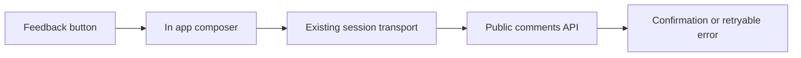

# Feedback Dialog Design

- Input: Feedback button activation, draft text, current session, optional guest password and motion preference.
- Output: An in app composer, a public comment confirmation or a retryable error.
- Code: src/components/Floating/FeedbackModal.tsx, src/components/Floating/FeedbackModal.module.css.

The existing FeedbackModal and submitSequencerFeedback remain in use. The backdrop fades in and the panel rises and scales into place over 220 ms. CSS disables both animations when reduced motion is requested.

- Spec: [Feedback Dialogs](../../specs/app/98-feedback-dialogs.md)
- Architecture: [Overview](../../architecture/10-overview.md)
- Scenarios: [Feedback Dialogs](../../testing/scenarios/app/98-feedback-dialogs.md)

## Example

- Input: A visitor opens Feedback with reduced motion disabled.
- Steps: Display the animated composer, enter a draft, receive a failed API response and retry explicitly.
- Expected result: The draft remains available for retry and clears only on success.

## Keyboard Interaction

Escape dismisses only the feedback composer when idle and is ignored during submission. Web feedback overlays trap Tab focus, restore the trigger on close and lock background scrolling; Hush Garden uses the existing React Native modal and captures Escape before the garden settings handler.
