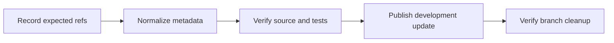

# History Integration

Preserve the existing development ancestry and every incoming source snapshot when changing commit metadata. A new commit ID is expected when author, committer, message or parent metadata changes.

## Verification

1. Record the existing development, main, release tag and source branch IDs. Confirm that the worktree is clean and that one source tip contains every target branch.
2. Recreate the incoming commits in parent order using the configured developer identity. Preserve their tree IDs and timestamps, and remove unwanted attribution trailers from messages.
3. Compare all original and recreated tree IDs. Update current documentation references to recreated commit IDs where needed.
4. Run the existing integration suites and production build. Compare the final tracked application source, tests, assets and configuration with the incoming source tip.
5. Verify commit format, excluded paths and documentation links. Remove temporary local checkpoint commits before publishing.
6. Recheck expected remote IDs. Atomically publish the development fast forward and delete only the two approved source branches with explicit leases. Confirm that main and release tags are unchanged.

Old objects may remain in local recovery data, other clones or hosting caches after ref deletion. Removing branch names does not establish physical erasure of those objects.

## Example

- Input: Two source branches where the newer branch contains the older branch, and 21 commits follow the existing development tip.
- Steps: Recreate the 21 commits, verify their snapshots and run the existing tests, advance development, and delete the two source refs atomically.
- Expected result: Development retains the incoming application source and existing ancestry, the incoming commits use the configured developer identity, and both source branch names are absent from the remote branch list.

The verification must complete before remote changes. Concurrent changes must reject the combined push rather than delete a branch containing unreviewed work.

- Scenarios: [History Integration Scenarios](../testing/scenarios/repository/10-history-integration.md).
- Terms: [Glossary](../10-glossary.md#commit-tree).
- Existing tests: [Integration Test Strategy](../testing.md).
