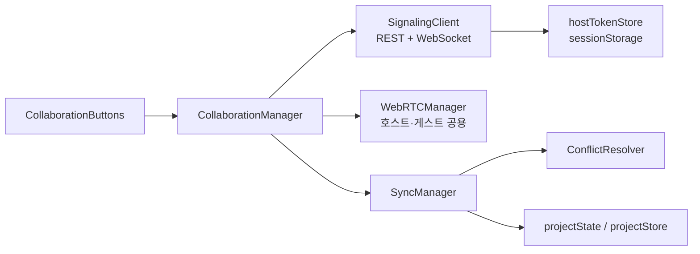

# 클라이언트 구현

**Document Version**: 2.0  
**Software Version**: 0.1.0  
**Last Updated**: 2026-11-03

> 2026-11-03에 `src/core/sync`의 실제 클래스와 공개 메서드 기준으로 다시 작성했습니다. 시그니처는 요약이며, 정확한 타입은 소스를 따릅니다.

---

## 구성



| 클래스 | 파일 | 역할 |
|---|---|---|
| `CollaborationManager` | `CollaborationManager.ts` | 화면이 쓰는 진입점. 호스팅·참가·종료, 시그널링 메시지를 WebRTC로 연결 |
| `SignalingClient` | `SignalingClient.ts` | 방 REST API와 WebSocket 시그널링, hostToken 관리 |
| `WebRTCManager` | `WebRTCManager.ts` | `isHost`에 따라 호스트(여러 게스트) 또는 게스트(호스트 1개) 연결 관리 |
| `SyncManager` | `SyncManager.ts` | 프로젝트 변경을 P2P 메시지로 주고받고 적용 |
| `ConflictResolver` | `ConflictResolver.ts` | 같은 대상의 동시 변경 충돌 감지·해결 |

`clientId`는 `getOrCreateClientId()`가 `localStorage`(`online-daw-client-id`)에 보관한 UUID이며, 호스트의 `hostId`로도 쓰입니다.

## 1. CollaborationManager

```typescript
class CollaborationManager {
  constructor(serverUrl?: string)
  connect(): Promise<void>                       // WebSocket 연결
  startHosting(): Promise<string>                // 방 생성·등록, 룸 코드 반환
  allowJoin(duration = 60): Promise<void>        // 호스트: 조인 허용
  kickParticipant(participantId: string): Promise<void>
  joinRoom(roomCode: string): Promise<void>      // 참가자: 조회 → WS join → WebRTC
  disconnect(): void                             // 종료 (호스트는 연결이 끊긴 경우에만 REST 삭제)
  onServerMessage(action, callback) / offServerMessage(action, callback)
  getIsHost() / getRoomCode() / getRoomExpiresAt() / getHostId()
  getConnectedGuests() / getHostConnectionState() / getGuestConnectionState(guestId)
}
```

- 재연결 시 `SignalingClient`의 방 복원 콜백으로 호스트는 재등록, 게스트는 재참가를 시도합니다.

## 2. SignalingClient

```typescript
class SignalingClient {
  connect(): Promise<void>                       // wss://…/online-sequencer/signaling?clientId=…
  registerRoom(hostId: string): Promise<string>  // POST /rooms + WS register
  getRoom(roomCode: string): Promise<RoomInfo>
  allowJoin(roomCode: string, duration = 60): Promise<void>  // 1~3600초로 보정
  joinRoom(roomCode: string): Promise<HostInfo>  // GET /rooms/{code} 후 allowJoin 확인, WS join
  kickParticipant(roomCode: string, participantId: string): Promise<void>
  deleteRoom(roomCode: string): Promise<void>
  getRoomExpiresAt(): number | null
  sendSignalingMessage(message: SignalingMessage): void
  onSignalingMessage(callback) / onMessage(action, callback) / offMessage(action, callback)
  onRoomRestore(callback) / offRoomRestore(callback)
  disconnect(): void                             // WS leave 전송 후 종료
}
```

**규칙**
- URL은 `src/utils/apiConfig.ts`의 `buildApiUrl()`·`buildWebSocketUrl()`로 만듭니다. API 주소는 `VITE_API_URL` 하나(코드 기본값 없음, 운영 `https://api.jace-s.com`)이고 협업 경로 `/online-sequencer`는 코드가 붙입니다.
- 방 조회는 선택 헤더 `x-client-id`를 보냅니다.
- 호스트 전용 요청(재등록·삭제·조인 허용·강퇴)은 `Authorization: Bearer {hostToken}`, WebSocket `register`는 `data.hostToken`을 씁니다. 재등록이 401·403·404로 거절되면 토큰 없이 새 방을 만듭니다.
- hostToken은 메모리와 같은 탭 `sessionStorage`(`hostTokenStore.ts`)에 보관합니다. 새로고침 후 자동 복구는 하지 않고, 다시 호스팅할 때 재등록에 씁니다. 로그에는 `[redacted]`로 남깁니다.
- 로그인 상태(허용 호스트)의 요청에는 `withJaceAuth()`로 쿠키와 변경 요청의 `x-csrf-token`을 붙입니다. 방 생성이 403 `CSRF_VALIDATION_FAILED`이면 세션을 다시 확인하고 한 번만 재시도합니다.
- 실패 응답은 `roomApiErrors.ts`가 코드별 문구로 바꿉니다.

## 3. WebRTCManager

하나의 클래스가 `isHost`로 역할을 나눕니다.

```typescript
class WebRTCManager {
  constructor(clientId: string, isHost = false, iceServers?: RTCConfiguration)
  // 호스트
  addGuest(guestId, offer): Promise<RTCSessionDescriptionInit>     // answer 반환
  handleGuestOffer(guestId, offer): Promise<RTCSessionDescriptionInit>
  removeGuest(guestId): void
  sendToGuest(guestId, message) / broadcastToAll(message) / broadcastToOthers(senderId, message)
  getConnectedGuests(): string[]
  // 게스트
  connectToHost(hostId): Promise<RTCSessionDescriptionInit>        // offer 생성
  setHostAnswer(answer): Promise<void>
  sendToHost(message): void
  getHostConnectionState(): ConnectionState | null
  // 공통
  addIceCandidate(peerId, candidate): Promise<void>
  getPeerConnectionState(peerId): ConnectionState | null
  disconnect(): void
}
```

- ICE 서버는 `config/iceServers.ts`(공개 STUN + 선택 TURN 환경 변수)를 씁니다.

## 4. SyncManager

```typescript
class SyncManager {
  constructor(collaborationManager: CollaborationManager)
  onGuestConnected(guestId): void        // 호스트: initial-state 전송
  requestInitialState(): void            // 게스트: state-request 전송
  broadcastChange(change: RemoteChange): void   // 호스트: 로컬 변경을 모든 게스트에게
  sendChangeToHost(change: RemoteChange): void  // 게스트: 로컬 변경을 호스트에게
  applyChange(change: RemoteChange): void
  applyProjectState(state): void         // 게스트: 초기 상태로 프로젝트 교체 (마이그레이션 후 setProject, 로컬 마스터 볼륨 유지)
  disconnect(): void
}
```

**흐름**
1. 게스트의 DataChannel이 열리면 `state-request` → 호스트가 `initial-state`로 응답 → 게스트가 프로젝트를 교체합니다.
2. 게스트의 변경은 `change`로 호스트에 보내고, 호스트는 `ConflictResolver`로 충돌을 처리한 뒤 적용하고 다른 게스트에게 `broadcastToOthers`로 중계합니다.
3. 호스트의 로컬 변경은 `broadcastToAll`로 모든 게스트에게 보냅니다.
4. 재생 상태는 `transport` 메시지(`play`·`pause`·`stop`·`seek`)로 맞춥니다.

메시지 형식은 [프로토콜 정의](./protocol.md)를 따릅니다.

---
