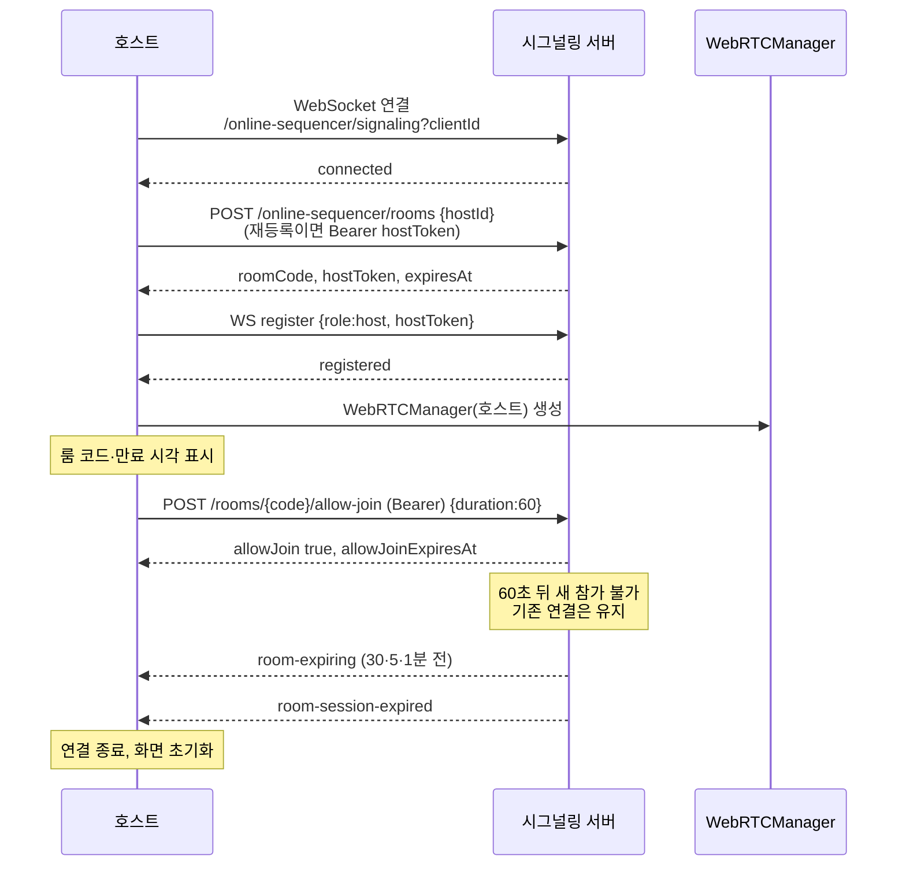
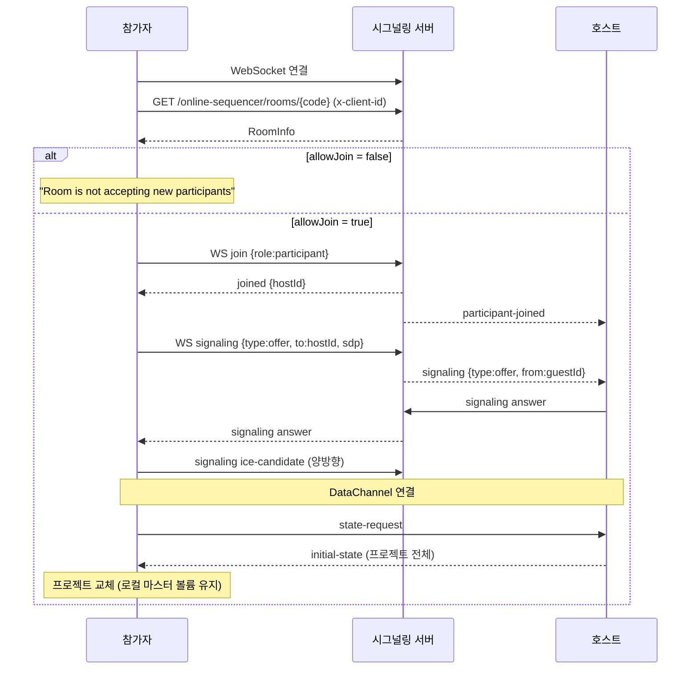

# 연결 플로우

**Document Version**: 2.0  
**Software Version**: 0.1.0  
**Last Updated**: 2026-11-03

> 2026-11-03에 jace-s 계약(`9416e01`)과 `src/core/sync`, `CollaborationButtons.tsx` 기준으로 다시 작성했습니다. 경로는 `https://api.jace-s.com` 기준입니다. API 상세는 [서버 API](./server-api.md)를 따릅니다.

---

## 1. 호스트 세션 시작



**단계**
1. Collaboration 드롭다운에서 "Host"를 누르면 `CollaborationManager.startHosting()`이 시작됩니다.
   - WebSocket이 없으면 먼저 연결합니다.
   - `POST /online-sequencer/rooms`로 방을 만듭니다. 같은 탭에 보관한 hostToken이 있으면 Bearer로 기존 방 재등록을 먼저 시도합니다.
   - 응답의 `hostToken`·`expiresAt`을 보관하고 WebSocket `register`(`data.hostToken`)로 호스트 등록을 마칩니다(5초 안에 `registered`가 없으면 실패).
2. 툴바에 룸 코드가 표시됩니다. 룸 코드를 누르면 참가자 목록, 만료 시각, 남은 시간이 보입니다.
3. "Allow 1min"을 누르면 `allow-join`(Bearer, 60초)을 호출하고 60초 카운트다운을 표시합니다. 다시 누르면 다시 60초가 열립니다.
4. 60초가 지나면 새 참가는 막히지만 기존 P2P 연결은 유지됩니다.
5. 만료 30·5·1분 전 서버의 `room-expiring`을 받으면 경고 토스트를 10초 표시합니다.
6. `room-session-expired`를 받으면 연결을 끊고 호스팅 화면을 닫은 뒤 "The room has expired. Start hosting again to continue."를 표시합니다.

**규칙**
- 호스팅 중에는 다시 "Host"를 할 수 없습니다(먼저 종료).
- 방 유지 시간은 서버가 정합니다(로그인 6시간, 비로그인 1시간). 재등록은 만료 시각을 연장하지 않습니다.
- 동시 활성 방은 신원당 하나이며, 생성 횟수 제한이 있습니다(409 `ACTIVE_ROOM_LIMIT`, 429 `RATE_LIMITED`).

## 2. 참가자 세션 참여



**단계**
1. Collaboration 드롭다운에서 "Join"을 누르고 4자리 룸 코드를 입력합니다. 현재 클라이언트는 조인 전에 작업 대체 경고를 띄우지 않습니다.
2. `GET /online-sequencer/rooms/{code}`로 방을 조회합니다. `allowJoin`이 false이면 "Room is not accepting new participants"를 표시합니다. 강퇴된 클라이언트는 403 `KICKED`를 받습니다.
3. WebSocket `join`을 보내고 `joined`로 호스트 ID를 받습니다(5초 제한).
4. 게스트가 offer를 만들어 `signaling`으로 보내고, 호스트가 answer를 돌려줍니다. ICE candidate도 `signaling`으로 주고받습니다.
5. DataChannel이 열리면 게스트가 `state-request`를 보내고 호스트가 `initial-state`로 응답합니다. 게스트는 호스트 상태로 프로젝트를 교체합니다(기존 작업 덮어쓰기).
6. 이후 변경은 P2P `change`로 오갑니다(게스트 → 호스트 → 다른 게스트).

시그널링 메시지 형식: `{action:"signaling", roomCode, clientId, data:{type, to, sdp?, candidate?}}`. 수신 측에는 `data.to` 대신 `data.from`이 들어옵니다.

## 3. P2P 통신과 방 만료

- 연결 후 프로젝트 변경과 재생 상태(`transport`)는 DataChannel로 주고받습니다(Star 토폴로지, 모든 게스트는 호스트와만 연결).
- 시그널링 서버는 P2P 데이터를 중계하지 않습니다.
- 조인 허용이 끝나도 기존 연결과 작업은 계속됩니다.
- 방이 만료되면 서버가 방을 지우고 `room-session-expired`를 보냅니다. 클라이언트는 연결을 끊고 화면을 초기화합니다. 각자의 프로젝트는 로컬에 남습니다.

## 4. 룸 나가기

| 주체 | 동작 |
|---|---|
| 호스트 "Stop Hosting" | WebSocket `leave`(연결이 끊긴 상태면 REST `DELETE`) → 서버가 방을 삭제하고 게스트에게 `room-closed` → P2P 종료. 보관한 hostToken 삭제. 5초 뒤 다시 호스팅 가능 |
| 게스트 "Leave" | WebSocket `leave` → 서버가 `participant-left` 방송 → P2P 종료. 호스트와 다른 게스트는 계속 작업 |
| 게스트가 `room-closed` 수신 | 화면 초기화, "The host has ended the session" 표시 |
| 게스트가 `kicked` 수신 | 연결 종료, "You have been kicked from the session" 표시 (서버가 항상 보내지는 않음) |

**통신 예시**
```
게스트1 change
  ↓ (P2P)
호스트: 충돌 처리 후 적용
  ↓ (P2P)            ↓ (P2P)
게스트2에게 중계      게스트3에게 중계
```

---
