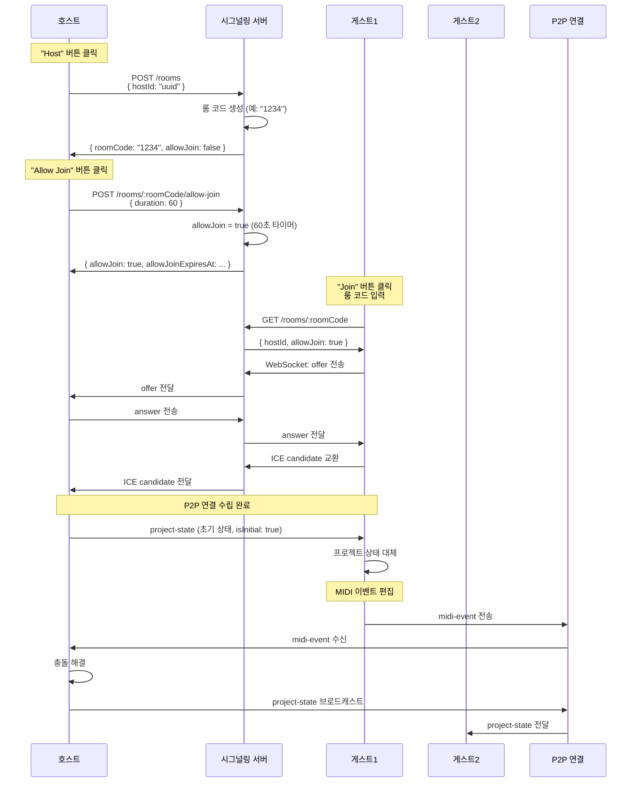

# 서버 API 스펙

**Document Version**: 2.0  
**Software Version**: 0.1.0  
**Last Updated**: 2026-11-03

---

## 기본 정보

> 계약 원문: jace-s 저장소(`JaceDashS/jace-s-platform`) `docs/api/apps/online-sequencer/` (`10-client-contract.md`, `20-health.md`, `30-app-contract.md`). 이 문서는 클라이언트 기준 요약이며 원문이 우선한다. 기준: jace-s 커밋 `9416e01` (2026-11-03 원문 대조).

- **API 주소**: `https://api.jace-s.com` (`VITE_API_URL`). 경로에 `/api`를 붙이지 않는다.
- **협업 REST**: `{API_URL}/online-sequencer/...`
- **WebSocket**: `wss://api.jace-s.com/online-sequencer/signaling?clientId={client-uuid}`
- **엔드포인트 표기**: 아래 `/rooms...` 경로는 `{API_URL}/online-sequencer` 기준 상대 경로다.
- **roomCode**: 4자리 문자열(`0000`~`9999`). 시간 값은 epoch 밀리초.
- **hostToken**: 새 방을 만들 때 한 번만 받는다. 호스트 전용 요청에 `Authorization: Bearer {hostToken}`으로 보낸다. URL이나 로그에 넣지 않는다.
- **hostToken 보관 (클라이언트)**: 로그인 여부와 관계없이 메모리와 `sessionStorage`(`online-sequencer-host-room`: hostId, roomCode, hostToken, expiresAt)에 보관한다. 서버 측 복구 기능은 없다.
  - 같은 탭에서 새로고침하면 방을 자동으로 되살리지 않는다. 사용자가 다시 호스팅을 시작하면 보관한 토큰으로 기존 방 재등록을 시도한다(생성 제한 제외, 만료 시각 유지).
  - 방 삭제, 호스팅 종료(leave), 해당 방의 `room-closed`·`room-session-expired`, `expiresAt` 경과, 재등록 거절(401/403/404) 때 지운다.
  - 탭을 닫으면 사라지며 다른 탭·기기와 공유하지 않는다. 구현: `src/core/sync/hostTokenStore.ts`
- **로그인 사용자**: 허용 Origin(`online-sequencer.jace-s.com`)에서 로그인한 경우 변경 요청에 `credentials: 'include'`와 `x-csrf-token`을 붙인다. 틀리면 403 `CSRF_VALIDATION_FAILED`. 비로그인 사용자는 둘 다 보내지 않는다. 상세: [서비스 공지와 로그인 명세](../service-notices-and-login.ko.md)
- **방 유지 시간**: 로그인 상태로 만든 방 6시간, 비로그인 1시간. 클라이언트는 고정 시간을 가정하지 않고 응답의 `expiresAt`을 쓴다. 재등록은 만료 시각을 연장하지 않는다.
- **생성 제한**: 성공 생성은 비로그인 IP당 1회·회원 5회/시간, 신원당 활성 방 1개, 실패 생성은 비로그인 3회·회원 10회/15분. 초과 시 429 `RATE_LIMITED`, 활성 방이 이미 있으면 409 `ACTIVE_ROOM_LIMIT`. 호스트 토큰을 가진 기존 방 재등록은 제한에서 제외된다.
- **WebSocket 호스트 인증**: 연결 자체는 인증하지 않고, `register` 메시지의 `data.hostToken`을 검증한다.
- **에러 형식**: `{success:false, error, code?, details?}`. 클라이언트는 `src/core/sync/roomApiErrors.ts`에서 코드별 문구로 바꿔 보여준다.
- **재등록 응답**: 같은 hostId로 재등록하면 `hostToken`이 `null`로 온다. 기존 토큰을 덮어쓰지 않는다.

| 방법과 경로 | 입력 | 성공 |
|---|---|---|
| `POST /rooms` | `{hostId}`. 기존 방 재등록은 `Authorization: Bearer {hostToken}` | 200 `{success, roomCode, hostId, hostToken, expiresAt, allowJoin, createdAt}` |
| `GET /rooms/{roomCode}` | 선택 헤더 `x-client-id` | 200 RoomInfo |
| `DELETE /rooms/{roomCode}` | `Authorization: Bearer {hostToken}` | 200 `{success, roomCode}` |
| `POST /rooms/{roomCode}/allow-join` | `Authorization: Bearer {hostToken}`, `{duration: 1~3600}`(초) | 200 `{success, allowJoin, allowJoinExpiresAt}` |
| `POST /rooms/{roomCode}/kick` | `Authorization: Bearer {hostToken}`, `{participantId}` | 200 `{success, message}` |

**없어진 경로**: `GET /online-sequencer/rooms`(방 목록, 예전 관리자용). 클라이언트는 사용하지 않는다. 개발자 패널 관리자 기능(비밀번호 확인·방 목록·강제 삭제)은 2026-11-03에 제거했다.

**예전 주소**: `https://jace-s.com/api/online-sequencer/...`, `https://api.jace-s.com/api/online-sequencer/...`, `wss://jace-s.com/api/online-sequencer/signaling`은 전환 기간에만 동작하며 이후 404가 된다. 클라이언트는 사용하지 않는다.

아래 상세는 기존 명세를 유지한 것이다. 위 표와 다르면 위 표가 우선한다.

## REST API 엔드포인트

### 1. 룸 등록 (호스트가 "Host" 클릭 시)

```
POST /rooms
Content-Type: application/json
Headers (재등록 시에만): { "Authorization": "Bearer {hostToken}" }

Request Body:
{
  "hostId": "uuid-here"
}

Response 200:
{
  "success": true,
  "roomCode": "1234",  // 서버가 생성한 비어있는 4자리 숫자
  "hostId": "uuid-here",
  "hostToken": "...",  // 새 방일 때 한 번만 반환
  "expiresAt": 1234567890123,  // 로그인 6시간, 비로그인 1시간 후
  "allowJoin": false,  // 초기값: 조인 불가
  "createdAt": 1234567890000
}

Response 400:
{
  "success": false,
  "error": "No available room codes"  // 모든 룸 코드가 사용 중인 경우 (매우 드묾)
}

Response 200: (호스트가 이미 룸이 있는 경우)
{
  "success": true,
  "roomCode": "1234",  // 기존 룸 코드 반환
  "hostId": "uuid",
  "status": "active",
  "allowJoin": false,
  "createdAt": 1234567890
}
```

**중요:**
- 룸 코드는 서버에서 생성하여 반환합니다
- 서버는 사용 가능한 4자리 숫자(0000-9999) 중 하나를 선택합니다
- 이미 사용 중인 룸 코드는 제외하고 할당합니다
- 룸 유지 시간: 로그인 상태 6시간, 비로그인 1시간
- 클라이언트는 재연결 시 보관한 hostToken으로 재등록을 시도하고, 401/403/404로 거절되면 토큰 없이 새 방을 만든다
- 초기 상태는 allowJoin: false (조인 불가)

### 2. 룸 조회 (참가자가 조인 시)

```
GET /rooms/:roomCode
Headers: { "x-client-id": "client-uuid" }  // 선택사항, 강퇴 확인용

Response 200:
{
  "success": true,
  "roomCode": "1234",
  "hostId": "uuid-here",
  "status": "active",
  "allowJoin": true,  // 조인 허용 여부
  "allowJoinExpiresAt": 1234567950123,  // 조인 허용 만료 시간 (60초 후)
  "participantCount": 1,
  "maxParticipants": 4,
  "createdAt": 1234567890123,  // 룸 생성 시간 (강퇴 확인용)
  "expiresAt": 1234567890123  // 룸 만료 시간 (6시간 후)
}

Response 404:
{
  "success": false,
  "error": "Room not found"
}

Response 403:
{
  "success": false,
  "error": "Join not allowed",  // allowJoin이 false이거나 강퇴된 경우
  "message": "Host has not allowed joining." or "You have been kicked from this room."
}
```

**강퇴 확인:**
- 클라이언트 ID가 제공되면 서버가 강퇴 여부 확인
- 같은 룸 인스턴스에서 강퇴된 경우: 403 Forbidden
- 새 룸 인스턴스인 경우: 200 OK (룸 생성 시간으로 판단)

### 2-1. 조인 허용 활성화 (호스트가 "Allow Join" 클릭 시)

**중요:** 호스트는 언제든지 이 API를 호출하여 조인 허용 상태로 만들 수 있습니다.
- 조인 허용이 만료된 후에도 다시 호출 가능
- 이미 조인 허용 상태인 경우 타이머가 재시작됨 (60초 연장)

```
POST /rooms/:roomCode/allow-join
Headers: { "Authorization": "Bearer {hostToken}" }
Content-Type: application/json

Request Body:
{
  "duration": 60  // 조인 허용 시간 (초)
}

Response 200:
{
  "success": true,
  "allowJoin": true,
  "allowJoinExpiresAt": 1234567950123  // 현재 시간 + 60초
}

Response 403:
{
  "success": false,
  "error": "Unauthorized"  // 호스트가 아닌 경우
}
```

**동작:**
- 조인 허용이 만료된 상태에서 호출: 즉시 조인 허용 상태로 전환 (60초 타이머 시작)
- 이미 조인 허용 상태인 경우: 타이머가 재시작되어 60초 연장
- 호스트는 언제든지 이 API를 호출할 수 있음

### 3. 룸 삭제 (호스트가 "Stop Hosting" 클릭 시, 또는 만료 시 자동)

```
DELETE /rooms/:roomCode
Headers: { "Authorization": "Bearer {hostToken}" }

Response 200:
{
  "success": true,
  "roomCode": "1234"
}

Response 403:
{
  "success": false,
  "error": "Unauthorized"
}
```

**참고:** 만료 시간(로그인 6시간, 비로그인 1시간)이 지나면 서버 룸은 만료되며 만료 이벤트가 전송됩니다. P2P 종료는 클라이언트 처리에 따라 달라집니다.

### 4. 참가자 강퇴 (호스트가 강퇴 버튼 클릭 시)

```
POST /rooms/:roomCode/kick
Headers: { "Authorization": "Bearer {hostToken}" }
Content-Type: application/json

Request Body:
{
  "participantId": "guest-uuid"
}

Response 200:
{
  "success": true,
  "message": "Participant kicked"
}

Response 403:
{
  "success": false,
  "error": "Unauthorized"
}

Response 404:
{
  "success": false,
  "error": "Participant not found"
}
```

**참고:** 
- 강퇴된 참가자는 현재 룸 인스턴스에서만 재조인이 거부됩니다
- 같은 호스트가 같은 룸 코드로 새 룸을 만들면 참가 가능합니다
- 다른 호스트가 같은 룸 코드를 사용해도 참가 가능합니다
- 강퇴는 룸 인스턴스 기준이지, 룸 코드나 호스트 기준이 아닙니다

### 5. 룸 만료 경고 (서버에서 자동 전송)

서버는 룸 만료 전에 WebSocket을 통해 경고 메시지를 전송합니다:

```
WebSocket 메시지 (서버 → 모든 클라이언트)
{
  "action": "room-expiring",
  "roomCode": "1234",
  "data": {
    "minutesLeft": 30  // 또는 5, 1
  }
}
```

**경고 시점:**
- 만료 30분 전, 5분 전, 1분 전 (6시간 방 기준 5시간 30분·55분·59분 경과)
- 비로그인 1시간 방의 경고 시점은 계약 원문(`30-app-contract.md`)을 확인하지 못했다

## WebSocket API

### 연결

```
wss://api.jace-s.com/online-sequencer/signaling?clientId=<client-uuid>
```

### 메시지 형식

```typescript
// 클라이언트 → 서버
interface ClientToServerMessage {
  action: 'register' | 'join' | 'signaling' | 'leave';
  roomCode: string;
  clientId: string;
  data?: any;
}

// 서버 → 클라이언트
interface ServerToClientMessage {
  action: 'connected' | 'registered' | 'joined' | 'signaling' | 'error' | 'room-closed' | 'kicked' | 'allow-join-expired' | 'room-expiring' | 'room-session-expired' | 'participant-joined' | 'participant-left';
  roomCode: string;
  data?: {
    minutesLeft?: number;  // 룸 만료까지 남은 시간 (분)
    roomCreatedAt?: number;  // 룸 생성 시간 (강퇴 확인용)
    participantId?: string;
    participantCount?: number;
    [key: string]: any;
  };
  error?: string;
}
```

### 메시지 플로우



**1. 호스트 등록**
```json
// 클라이언트 → 서버
{
  "action": "register",
  "roomCode": "1234",
  "clientId": "host-uuid",
  "data": {
    "role": "host",
    "hostToken": "issued-host-token"  // 필수: POST /rooms에서 받은 토큰
  }
}

// 서버 → 클라이언트
{
  "action": "registered",
  "roomCode": "1234",
  "data": {
    "status": "active"
  }
}
```

**2. 참가자 참여**
```json
// 클라이언트 → 서버
{
  "action": "join",
  "roomCode": "1234",
  "clientId": "client-uuid",
  "data": {
    "role": "participant"
  }
}

// 서버 → 클라이언트
{
  "action": "joined",
  "roomCode": "1234",
  "data": {
    "hostId": "host-uuid",
    "status": "active"
  }
}
```

**3. 시그널링 메시지 전달**
```json
// 참가자 → 서버 → 호스트
{
  "action": "signaling",
  "roomCode": "1234",
  "clientId": "client-uuid",
  "data": {
    "type": "offer",
    "to": "host-uuid",
    "sdp": {...}
  }
}
```

---
