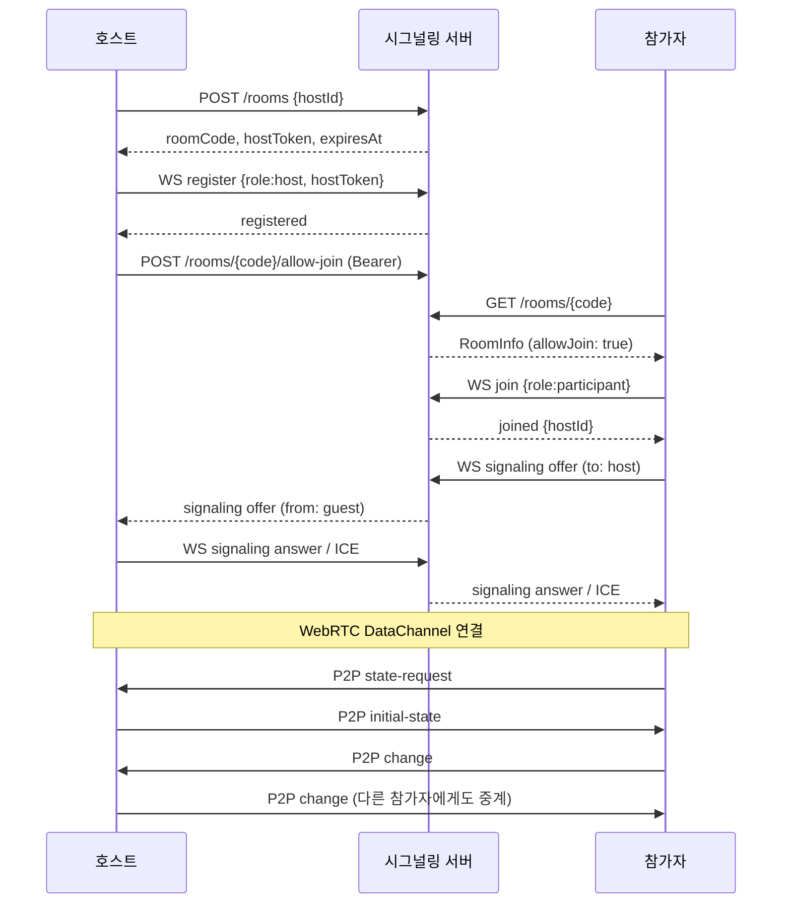

# 서버 API 스펙

**Document Version**: 3.0  
**Software Version**: 0.1.0  
**Last Updated**: 2026-11-03

---

## 기본 정보

> 계약 원문: jace-s 저장소(`JaceDashS/jace-s-platform`) `docs/api/apps/online-sequencer/` (`10-client-contract.md`, `20-health.md`, `30-app-contract.md`). 이 문서는 클라이언트 기준 요약이며 원문이 우선한다. 기준: jace-s 커밋 `9416e01` (2026-11-03 원문 대조).

- **API 주소**: `https://api.jace-s.com` (`VITE_API_URL`). 경로에 `/api`를 붙이지 않는다.
- **협업 REST**: `{API_URL}/online-sequencer/...`
- **WebSocket**: `wss://api.jace-s.com/online-sequencer/signaling?clientId={client-uuid}`
- **엔드포인트 표기**: 아래 `/rooms...` 경로는 `{API_URL}/online-sequencer` 기준 상대 경로다.
- **roomCode**: 4자리 문자열(`0000`~`9999`). 시간 값은 epoch 밀리초.
- **hostToken**: 새 방을 만들 때 한 번만 받는다. 호스트 전용 요청에 `Authorization: Bearer {hostToken}`으로 보낸다. URL이나 로그에 넣지 않는다.
- **hostToken 보관 (클라이언트)**: 로그인 여부와 관계없이 메모리와 `sessionStorage`(`online-sequencer-host-room`: hostId, roomCode, hostToken, expiresAt)에 보관한다. 서버 측 복구 기능은 없다.
  - 같은 탭에서 새로고침하면 방을 자동으로 되살리지 않는다. 사용자가 다시 호스팅을 시작하면 보관한 토큰으로 기존 방 재등록을 시도한다(생성 제한 제외, 만료 시각 유지).
  - 방 삭제, 호스팅 종료(leave), 해당 방의 `room-closed`·`room-session-expired`, `expiresAt` 경과, 재등록 거절(401/403/404) 때 지운다.
  - 탭을 닫으면 사라지며 다른 탭·기기와 공유하지 않는다. 구현: `src/core/sync/hostTokenStore.ts`
- **로그인 사용자**: 허용 Origin(`online-sequencer.jace-s.com`)에서 로그인한 경우 변경 요청에 `credentials: 'include'`와 `x-csrf-token`을 붙인다. 틀리면 403 `CSRF_VALIDATION_FAILED`. 비로그인 사용자는 둘 다 보내지 않는다. 상세: [서비스 공지와 로그인 명세](../service-notices-and-login.md)
- **방 유지 시간**: 로그인 상태로 만든 방 6시간, 비로그인 1시간. 클라이언트는 고정 시간을 가정하지 않고 응답의 `expiresAt`을 쓴다. 재등록은 만료 시각을 연장하지 않는다.
- **생성 제한**: 성공 생성은 비로그인 IP당 1회·회원 5회/시간, 신원당 활성 방 1개, 실패 생성은 비로그인 3회·회원 10회/15분. 초과 시 429 `RATE_LIMITED`, 활성 방이 이미 있으면 409 `ACTIVE_ROOM_LIMIT`. 호스트 토큰을 가진 기존 방 재등록은 제한에서 제외된다.
- **WebSocket 호스트 인증**: 연결 자체는 인증하지 않고, `register` 메시지의 `data.hostToken`을 검증한다.
- **에러 형식**: `{success:false, error, code?, details?}`. 클라이언트는 `src/core/sync/roomApiErrors.ts`에서 코드별 문구로 바꿔 보여준다.
- **재등록 응답**: 같은 hostId로 재등록하면 `hostToken`이 `null`로 온다. 기존 토큰을 덮어쓰지 않는다.

| 방법과 경로 | 입력 | 성공 |
|---|---|---|
| `POST /rooms` | `{hostId}`. 기존 방 재등록은 `Authorization: Bearer {hostToken}` | 200 `{success, roomCode, hostId, hostToken, expiresAt, allowJoin, createdAt}` |
| `GET /rooms/{roomCode}` | 선택 헤더 `x-client-id` | 200 RoomInfo |
| `DELETE /rooms/{roomCode}` | `Authorization: Bearer {hostToken}` | 200 `{success, roomCode}` |
| `POST /rooms/{roomCode}/allow-join` | `Authorization: Bearer {hostToken}`, `{duration: 1~3600}`(초) | 200 `{success, allowJoin, allowJoinExpiresAt}` |
| `POST /rooms/{roomCode}/kick` | `Authorization: Bearer {hostToken}`, `{participantId}` | 200 `{success, message}` |

**없어진 경로**: `GET /online-sequencer/rooms`(방 목록, 예전 관리자용). 클라이언트는 사용하지 않는다. 개발자 패널 관리자 기능(비밀번호 확인·방 목록·강제 삭제)은 2026-11-03에 제거했다.

**예전 주소**: `https://jace-s.com/api/online-sequencer/...`, `https://api.jace-s.com/api/online-sequencer/...`, `wss://jace-s.com/api/online-sequencer/signaling`은 전환 기간에만 동작하며 이후 404가 된다. 클라이언트는 사용하지 않는다.

## RoomInfo

`GET /rooms/{roomCode}` 성공 응답:

```json
{
  "success": true,
  "roomCode": "0042",
  "hostId": "host-uuid",
  "status": "active",
  "allowJoin": false,
  "allowJoinExpiresAt": null,
  "participantCount": 1,
  "maxParticipants": 4,
  "createdAt": 1793700000000,
  "expiresAt": 1793703600000
}
```

- `status`: `active` 또는 `expired`
- GET은 참가자 등록을 하지 않는다. 참가는 WebSocket `join`으로 한다.
- `x-client-id`를 보내면 서버가 강퇴 기록을 확인해 403 `KICKED`를 반환할 수 있다.
- 조인 가능 여부는 응답의 `allowJoin`으로 판단한다. 클라이언트는 `allowJoin`이 false이면 "Room is not accepting new participants"를 표시한다(`SignalingClient.joinRoom`).

## 요청별 규칙

| 요청 | 규칙 |
|---|---|
| `POST /rooms` (새 방) | 로그인 불필요. 로그인 상태면 쿠키와 `x-csrf-token`을 함께 보내 6시간 방을 받는다. 생성 제한 대상 |
| `POST /rooms` (재등록) | `Authorization: Bearer {hostToken}` 필요. 생성 제한 제외, 만료 시각 유지, 응답 `hostToken`은 `null` |
| `POST /rooms/{roomCode}/allow-join` | `duration`은 초 단위 정수 1~3600. 생략·falsy이면 서버가 60으로 처리. 응답의 만료 시각은 방이 아니라 조인 허용의 만료 |
| `POST /rooms/{roomCode}/kick` | 강퇴 기록과 참가자 목록을 바꾼다. 현재 서버는 이 REST 경로에서 WebSocket `kicked`를 직접 보내지 않으므로 이벤트가 온다고 가정하지 않는다 |
| `DELETE /rooms/{roomCode}` | 호스트 토큰으로 방을 삭제한다. 활성 방 슬롯은 비워지지만 시간당 생성 횟수는 돌아오지 않는다 |

## HTTP 에러

형식: `{ "success": false, "error": string, "code"?: string, "details"?: unknown }`. 프록시·인프라 오류는 JSON이 아닐 수 있다.

| 상태 | 코드와 의미 | 클라이언트 표시 (`roomApiErrors.ts`) |
|---|---|---|
| 400 | `INVALID_INPUT`, `INVALID_ROOM_CODE`, `INVALID_HOST_ID`, `INVALID_PARTICIPANT_ID`, `INVALID_DURATION` | 코드별 문구 또는 서버 문구 |
| 401 | `UNAUTHORIZED` 호스트 토큰 없음 | Host authorization failed |
| 403 | `UNAUTHORIZED` 토큰 불일치, `KICKED`, 로그인 세션 새 방 생성 시 `CSRF_VALIDATION_FAILED` | CSRF는 세션 재확인 후 1회 재시도 |
| 404 | `ROOM_NOT_FOUND`, `PARTICIPANT_NOT_FOUND` | Room not found / Participant not found |
| 409 | `NO_AVAILABLE_ROOM_CODES`, `ACTIVE_ROOM_LIMIT` | 활성 방 있음 안내 등 |
| 429 | `RATE_LIMITED` (`Retry-After` 초) | 잠시 후 다시 시도 안내. 다른 Origin에서는 `Retry-After`를 읽을 수 없다(CORS Expose 미설정) |
| 500 | `INTERNAL_ERROR` | `Failed to … (HTTP 500)` |

중복 요청 방지 키(Idempotency Key)가 없으므로, 방 생성은 timeout 뒤 무조건 반복하지 않는다. 예외는 403 `CSRF_VALIDATION_FAILED` 1회 재시도뿐이다(이 경우 방이 만들어지지 않음).

## WebSocket API

### 연결

```
wss://api.jace-s.com/online-sequencer/signaling?clientId=<client-uuid>
```

- `clientId`가 없거나 Origin이 허용되지 않으면 close code 1008로 끊긴다.
- 첫 메시지는 `{action:"connected", clientId, timestamp}`.
- 모든 메시지는 JSON 텍스트다. 잘못된 JSON에는 `{action:"error", error:"Invalid message format"}`.
- 연결은 사용자 세션으로 인증하지 않는다. 호스트 `register`에서 `hostToken`을 검증한다.
- 서버는 메시지의 `clientId`보다 연결 URL의 `clientId`를 발신자로 쓴다.
- TURN/STUN 자격 증명 API는 없다. ICE 서버는 클라이언트 설정(`src/core/sync/config/iceServers.ts`)을 쓴다.

### 클라이언트 → 서버

공통: `{action, roomCode, clientId, data?}`

| action | data | 성공 응답 |
|---|---|---|
| `register` | `{role:"host", hostToken}` (토큰 필수) | `registered` `{roomCode, data:{status:"active"}}` |
| `join` | `{role:"participant"}` (생략 시 participant). `allowJoin`이 true여야 하고 정원·강퇴 검사를 통과해야 함. 호스트 자신은 참가 불가 | `joined` `{roomCode, data:{hostId, status, roomCreatedAt}}` |
| `signaling` | `{type:"offer"|"answer"|"ice-candidate", to, sdp?, candidate?}` | 수신자에게 `data.to` 대신 `data.from`이 들어간 `signaling` |
| `leave` | 없음 | 참가자: `participant-left` 방송. 호스트: `room-closed` 알림 후 방 삭제 |

잘못된 방·역할·토큰 등은 `{action:"error", error:string}`로 온다. HTTP 코드 체계와 같다고 가정하지 않는다.

### 서버 → 클라이언트 이벤트

| action | 내용과 클라이언트 처리 |
|---|---|
| `connected` | 연결 확인. 이후 register 또는 join |
| `registered` | 호스트 등록 완료 |
| `joined` | 참가 완료. `data.hostId`로 호스트 식별 |
| `signaling` | WebRTC offer/answer/ICE 전달 (`data.from`) |
| `error` | 오류 문자열. 등록·참가 대기 중이면 실패 처리 |
| `participant-joined` / `participant-left` | `data.participantId`, `data.participantCount` |
| `room-closed` | 방 종료. 보관한 호스트 토큰 삭제 |
| `kicked` | 세션 종료. 모든 강퇴 경로에서 오지는 않음 |
| `allow-join-expired` | 조인 허용 만료. 모든 만료에서 온다고 보장하지 않음 |
| `room-expiring` | `data.minutesLeft` (서버가 30·5·1분 조건을 주기적으로 검사). 클라이언트는 경고 토스트 10초 표시 |
| `room-session-expired` | 방 만료. 보관한 호스트 토큰 삭제, 연결 종료, 호스팅·참가 화면 닫고 만료 토스트 표시 |

### 전체 흐름



P2P 메시지(`initial-state`, `state-request`, `change`, `transport`)는 [프로토콜 정의](./protocol.md)를 따른다. 시그널링 서버는 P2P 데이터를 중계하지 않는다.

## 배포 제약

- 방과 소켓은 서버 프로세스 메모리에 있다. 서버를 재시작·재배포하면 열린 방이 닫힌다.
- REST와 WebSocket은 같은 api 프로세스의 room store를 써야 한다.
- CORS 허용 Origin과 WebSocket Origin 확인은 같은 규칙이다. 현재 허용 요청 헤더: Content-Type, Authorization, X-CSRF-Token, X-Requested-With, X-Forwarded-For, X-Origin, X-Client-Id, X-Host-Id.
